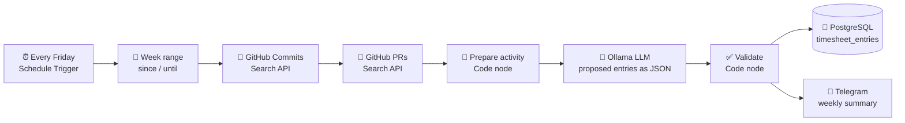

# n8n AI Timesheet

> An automated weekly workflow that turns my GitHub activity into proposed timesheet entries using a **local LLM**, validates them, stores them in **PostgreSQL** and sends me a summary for review.


-black)


---

## Why this project

Filling in timesheets by hand is tedious and often inaccurate: at the end of the week, developers have to remember what they worked on, on which project, and for how long. Yet most of that information already exists in the tools they use every day — commits, pull requests, tickets.

This project is a small proof of concept of an **AI-assisted timesheet system**:

- the developer's activity is **collected automatically** from the GitHub API,
- an LLM **proposes** timesheet entries (project, date, description, estimated duration),
- deterministic code **checks** the proposal before anything is saved,
- the developer stays **in control** and reviews the result instead of writing it from scratch.

Everything runs **locally and for free**: self-hosted n8n, a local LLM through Ollama (no data sent to a third-party AI API), and PostgreSQL — all in Docker.

---

## How it works



| # | Node | Role | Status |
|---|------|------|--------|
| 1 | **Every Friday** (Schedule Trigger) | Runs the workflow every Friday at 18:00 (Africa/Tunis) | ✅ Done |
| 2 | **Week range** (Edit Fields) | Computes the reporting window: `since` = today − 7 days, `until` = today | ✅ Done |
| 3 | **GitHub Commits** (HTTP Request) | `GET /search/commits` — my commits in the window, all repositories | ✅ Done |
| 4 | **GitHub PRs** (HTTP Request) | `GET /search/issues?q=type:pr` — my pull requests updated in the window | 🚧 In progress |
| 5 | **Prepare activity** (Code) | Keeps only useful fields (repo, date, message, PR title) to reduce LLM tokens | 🚧 In progress |
| 6 | **Ollama LLM** | Groups activity into timesheet entries and returns strict JSON | ⏳ Planned |
| 7 | **Validate** (Code) | Detects days without activity, duplicate entries, computes total hours per day | ⏳ Planned |
| 8 | **PostgreSQL** | Inserts the validated entries into `timesheet_entries` | ⏳ Planned |
| 9 | **Telegram** | Sends a readable weekly summary with warnings for review | ⏳ Planned |

---

## LLM output format

The LLM is asked to return **only** a JSON array, one object per entry:

```json
[
  {
    "project": "manaiyossra/internship-tracker",
    "date": "2026-11-05",
    "description": "Implemented candidate dashboard filters and fixed pagination bug",
    "estimated_hours": 3.5
  }
]
```

The LLM's answer is never trusted blindly: the **Validate** node parses it and applies deterministic rules before saving.

## Validation rules

| Rule | Behaviour |
|------|-----------|
| Invalid / non-JSON answer | Workflow stops and reports the error |
| Weekday with no activity | Flagged in the summary ("no activity on Wednesday") |
| Duplicate entries (same project + date + description) | Merged / removed |
| Total hours per day | Computed; days above 10 h are flagged |
| Out-of-range dates | Entries outside the reporting window are rejected |

---

## Tech stack

| Layer | Technology |
|-------|-----------|
| Orchestration | [n8n](https://n8n.io) (self-hosted, Docker) |
| Data source | GitHub REST API (Search commits & issues) |
| AI | [Ollama](https://ollama.com) running `qwen2.5:7b` (dev) / `qwen2.5:14b` (final) locally |
| Logic | JavaScript Code nodes |
| Storage | PostgreSQL 16 (Docker) |
| Notification | Telegram Bot API |
| Infrastructure | Docker Compose |

---

## Getting started

### Prerequisites

- [Docker Desktop](https://www.docker.com/products/docker-desktop) (WSL2 backend on Windows)
- [Ollama](https://ollama.com/download) installed on the host, with a model pulled:
  ```bash
  ollama pull qwen2.5:7b
  ```
- A GitHub account and a **fine-grained personal access token** (read-only)

### 1. Clone and configure

```bash
git clone https://github.com/manaiyossra/n8n-ai-timesheet.git
cd n8n-ai-timesheet
cp .env.example .env        # then edit the password
```

### 2. Start n8n and PostgreSQL

```bash
docker compose up -d
```

- n8n: <http://localhost:5678>
- PostgreSQL: `localhost:5433` (inside Docker: `postgres:5432`)
- n8n reaches Ollama on the host through `http://host.docker.internal:11434`

### 3. Create a GitHub token

GitHub → **Settings → Developer settings → Personal access tokens → Fine-grained tokens**

- Repository access: **All repositories**
- Permissions (read-only): **Contents**, **Pull requests**, **Metadata**

### 4. Import the workflow

In n8n: **⋯ → Import from File** → select `workflow.json`, then:

1. Create a **GitHub API** credential with your username and token.
2. In the **Week range** node, replace `username` with your GitHub username.
3. Click **Execute workflow** to test it immediately (no need to wait for Friday).

---

## Project structure

```
n8n-ai-timesheet/
├── docker-compose.yml   # n8n + PostgreSQL
├── .env.example         # environment variables template
├── workflow.json        # exported n8n workflow
└── README.md
```

## Security

- The GitHub token is **read-only** and stored only in n8n's encrypted credentials — never in the repository.
- `workflow.json` only contains a credential **reference** (name and id), not the secret.
- `.env` is excluded by `.gitignore`; only `.env.example` is published.
- The LLM runs **locally**: commit messages and repository names never leave the machine.

---

## Roadmap

- [x] Docker setup (n8n + PostgreSQL) and local Ollama
- [x] Weekly schedule trigger and reporting window
- [x] Fetch commits from the GitHub API
- [ ] Fetch pull requests
- [ ] LLM node producing structured JSON
- [ ] Validation Code node
- [ ] Save entries to PostgreSQL
- [ ] Telegram summary
- [ ] Screenshots and demo GIF
- [ ] Possible extensions: Jira issues as an additional source, approval step before saving, dashboard on top of PostgreSQL

---

## Screenshots

_Coming soon — workflow canvas, LLM output and Telegram summary._

---

## Author

**Yossra Manai** — final-year software engineering student at ESPRIT School of Engineering, Tunisia
[LinkedIn](https://www.linkedin.com/in/yossra-manai) · [GitHub](https://github.com/manaiyossra)
